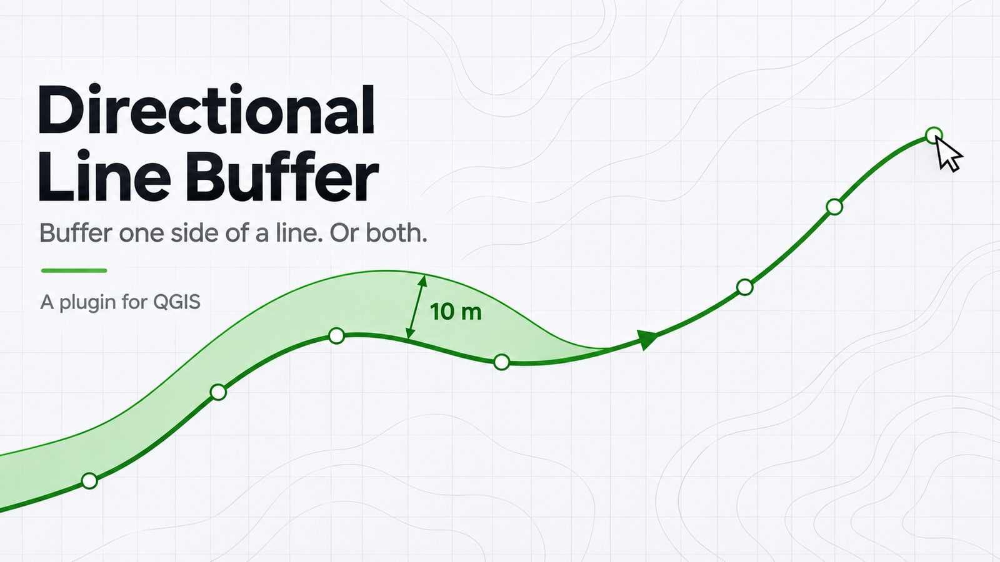
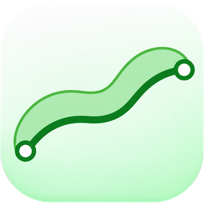

<h1 align="center">Directional Line Buffer</h1>

<p align="center">
  
</p>

<p align="center">
  
</p>

<p align="center">
  <strong>Draw a line on your map. Get a buffer on the left, the right, or both sides.</strong><br>
  Set the distance in meters and see the result before you save it.
</p>

<p align="center">
  
  
  
  <a href="Directional_line_buffer_Tool/LICENSE"></a>
</p>

A normal buffer grows on every side of a line. Many jobs need only one side: a setback from a road, a riparian strip along a river, a corridor next to a pipeline, a one-sided right-of-way. Directional Line Buffer draws that polygon for you, straight on the map canvas, with no need to build the line first.

What you can do:

- Click a line on the map and watch the buffer polygon follow your mouse.
- Pick **Left**, **Right** or **Both** sides, and type the distance in meters.
- Draw as many buffers as you like without reopening the dialog.
- Save each polygon into your own polygon layer, or into a temporary layer the plugin creates.
- Undo the last polygon when you write into a layer that is already in edit mode.

**The result is a real polygon.** Every buffer is written as a feature, with its distance and side stored in the attribute table.

---

## Features

| Feature | What it does |
|---|---|
| Directional buffers | Left, right or both sides of the line you digitize. For a line drawn east, left is north and right is south. |
| Live preview | The polygon redraws as the mouse moves, so you see the shape before you finish the line. |
| Your layer or ours | Select a writable polygon layer first and the plugin saves into it. Select nothing and it creates a temporary `Directional buffer` layer. |
| CRS transformation | The polygon is transformed when your target layer uses a different CRS than the project. |
| Safe saving | Invalid, empty or degenerate buffers are rejected with a warning and never written. |
| Attributes | `distance_m` and `side` are filled in when those fields exist in the target layer. |
| Offline help | Open the help page from **Plugins > Directional Line Buffer > Directional Line Buffer Help**. |

---

## Getting started

1. Open **Plugins > Manage and Install Plugins** in QGIS.
2. Search for **Directional Line Buffer** and click **Install Plugin**. To use a downloaded file, choose **Install from ZIP** instead.
3. Set your project CRS to a projected system that uses meters, for example a local UTM zone.
4. Optionally select a writable polygon layer in the Layers panel.
5. Click the **Directional Line Buffer** toolbar icon, then choose the distance and the side.

The plugin is marked experimental. Enable **Show also experimental plugins** in the Plugin Manager settings to see it.

---

## How to draw

1. Left-click to add vertices. Move the mouse to preview the polygon.
2. Finish the line with a **right-click**, a **double-click** or **Enter**.
3. Keep drawing. The next line starts a new buffer.
4. Press **Escape** once to drop an unfinished line. Press it again on a clean canvas to leave the tool.

The default distance is 10 m and the minimum is 0.01 m.

Single-side buffers use mitered joins (12 segments, miter limit 5). Both-side buffers use the standard QGIS round buffer (12 segments).

---

## Where your polygons go

- **A writable polygon layer selected before you start** receives each polygon. The layer is locked in when digitizing begins, even if you select another layer later.
- **No compatible layer selected** creates a temporary memory layer named `Directional buffer`, in the project CRS, with `distance_m` and `side` fields. The plugin reuses only layers it created itself.
- **A layer already in edit mode** records each polygon as one undoable edit.
- **A layer not in edit mode** is edited and committed right away.
- **A write the layer rejects** triggers a warning, and the plugin saves into the temporary layer. If a commit may have partly succeeded, the plugin makes no fallback copy. Check the target layer and the QGIS Log Messages panel before you try again, to avoid duplicates.

**Save temporary results to a file before you close the project.** Memory layers disappear when QGIS closes.

---

## When something goes wrong

| What you see | What to do |
|---|---|
| Meter CRS warning | Switch the project to a projected CRS in meters. Latitude and longitude are not accepted. |
| CRS changed warning | Start the line again. Points from the previous CRS are discarded. |
| Invalid or empty buffer | Place at least two distinct points. Simplify sharp bends, loops and crossings. |
| Output went to the temporary layer | The selected layer was read-only, removed, incompatible or rejected the feature. Check its properties and constraints. |
| Commit may be partial | Inspect the target layer and the log before you repeat the action. |
| Output missing after restart | The result sat in an unsaved temporary layer. |

---

## Limits

- Distances are planar and use the units of the project CRS. They are not geodesic. Choose a projection that suits your region and accuracy needs.
- Layers with mandatory fields, triggers, geometry constraints, Z/M requirements or a different geometry type can reject writes.
- The tool draws new single-part lines. It does not buffer lines that already exist in a layer.
- Buffers can be multipart when the geometry requires it.
- The preview redraws on every mouse move and can lag on very long lines. No benchmark exists yet.
- The plugin declares support for QGIS 3.30 through 3.99. QGIS 4 and Qt 6 are untested and excluded.
- Testing so far used unit tests and mocked QGIS objects. Wider testing in QGIS desktop is planned, which is why the plugin stays experimental.

---

## For developers

The installable plugin lives in [`Directional_line_buffer_Tool/`](Directional_line_buffer_Tool/). Do not install the whole repository as a plugin. Build the upload ZIP with the packaging script.

```bash
python3 scripts/package_plugin.py --source Directional_line_buffer_Tool --output dist/DirectionalLineBuffer.zip
```

- [Development, validation, tests and packaging](DEVELOPMENT.md)
- [Release readiness](docs/QGIS_PLUGIN_RELEASE_READINESS.md)
- [Audit report](docs/QGIS_PLUGIN_AUDIT_REPORT.md) and [test report](docs/QGIS_PLUGIN_TEST_REPORT.md)

---

## Contributing

Report bugs and ideas in the [issue tracker](https://github.com/vchhikara/directional-line-buffer-tool/issues). Include your QGIS version, your operating system and the steps that led to the problem.

Directional Line Buffer is free software under the GNU General Public License, version 3 or later. See [LICENSE](Directional_line_buffer_Tool/LICENSE). Copyright (c) Vipul Chhikara.
